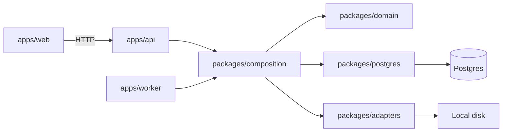

> This is a portfolio version of a production system I built for a company whose confidentiality policy does not allow the real product to be shown. The original work cannot be published. This repository is a different version, created only for the portfolio: it follows the same architecture decisions, with a different scope, brand, and data. It is not the client's codebase.

# Draftline

Draftline is a writing workspace. An editor enqueues a brief. The API stores a job and returns its id. A worker calls the model, writes the draft to object storage, and spends one credit. A viewer can read the queue and gets 403 if they try to enqueue.

The technical decision is recorded in [docs/adr/0002-decision.md](docs/adr/0002-decision.md). The portfolio context is in [docs/adr/0001-portfolio-version.md](docs/adr/0001-portfolio-version.md).

## Decision

The model call leaves the request. `POST /jobs` persists `queued` and does not use `ModelGateway`. The worker claims the job, checks the tenant credit balance, and only then calls the model. Zero credits marks the job `failed` without a model call and without a file. A successful generation debits credits in the same Postgres transaction that marks the job `succeeded`.

Lists and saved drafts are cached (`private, max-age=60`, TanStack Query `staleTime` 60s). Job detail is not (`no-store`, `staleTime: 0`, refetch until `succeeded` or `failed`). This version has one tenant, a fake model adapter, and local disk behind the same ports.

## Diagram



```
apps/web                  Next.js UI. TanStack Query owns server state.
apps/api                  HTTP adapter. Auth, cache headers, error mapping.
apps/worker               Claim loop. SIGTERM finishes the current job and closes the pool.
packages/domain           identity, tenancy, jobs, budget, files. No framework and no driver.
packages/composition      The only composition root. Chooses the fake model and disk storage.
packages/postgres         Parameterized SQL, versioned migrations, seed, reset.
packages/adapters         FakeModelGateway, DiskObjectStorage, clock, password hasher, logger.
packages/contracts        Request schemas and the cache-header policy.
```

Ports live in `packages/domain/src/ports.ts`: `ModelGateway`, `ObjectStorage`, `JobQueue`, `Clock`.

## Run

Requirements: Node.js 22, pnpm 10 (`corepack pnpm`), and Docker.

Postgres listens on host port **5433**. The web app uses **3201**. The API uses **3202**. `docker compose up -d` starts that database. When nothing is listening on 5433, `pnpm dev`, `pnpm test`, and `pnpm test:e2e` start a local Postgres cluster on the same port and leave it running.

```powershell
copy .env.example .env
```

Set `SESSION_SECRET`, `SEED_EDITOR_PASSWORD`, and `SEED_VIEWER_PASSWORD` in `.env`. The values in `.env.example` are placeholders.

```powershell
docker compose up -d
corepack pnpm install
corepack pnpm migrate
corepack pnpm seed
corepack pnpm dev
```

Open http://localhost:3201 and sign in as `editor@draftline.example` or `viewer@draftline.example` with the passwords you set.

`pnpm dev` starts the API, the worker, and the web app. The worker waits `JOB_VISIBILITY_DELAY_MS` before it can claim a new job, so the queued state is visible, then the fake model waits `FAKE_MODEL_DELAY_MS`.

The worker closes its pool on SIGTERM and SIGINT after the current job finishes.

## Test

```powershell
corepack pnpm typecheck
corepack pnpm lint
corepack pnpm test
corepack pnpm test:e2e
```

`pnpm test` runs domain tests, React Testing Library, and the Postgres integration test. The integration test needs the Compose database on port 5433 and creates `draftline_test`. It shows that:

- `POST /jobs` stores `queued` and does not call the model
- the worker does call the model and writes the file
- a zero balance does not call the model and does not write a file

`pnpm test:e2e` signs in as the editor and waits for the on-screen status to move from Queued to Succeeded.

## Tradeoffs

- The fake model and the disk are real adapters, not a second code path. Swapping a provider means a different `ModelGateway` in the composition root.
- Postgres is the queue. That avoids another service and keeps the claim in the same database as the credit debit. A separate broker would only pay off with more workers than this version needs.
- The credit check before the model call is what keeps a zero balance from spending a request. The debit is repeated inside the success transaction so two workers cannot both succeed on the last credit. If the balance hits zero after the check, the transaction refuses the debit and the file is deleted.
- Job detail is `no-store` even after success, because that response also carries the live status. The saved brief, which does not change while you read the list, is the cached draft.
- `JOB_VISIBILITY_DELAY_MS` holds a job in `queued` so a person can see the transition. Set it to `0` when you do not need that pause. The integration test does.

## Out of scope

Several models, token streaming, real billing, and vector search.
