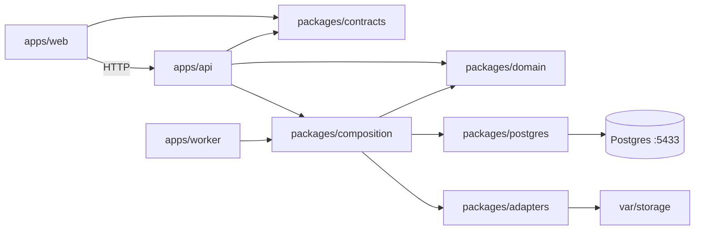

This is a portfolio version of a production system I built for a company whose confidentiality policy does not allow the real product to be shown. The original work cannot be published. This repository is a different version, created only for the portfolio: it follows the same architecture decisions, with a different scope, brand, and data. It is not the client's codebase.

# Draftline

Draftline is a writing workspace. An editor enqueues a brief. The API stores a job and returns its id. A worker calls the model, writes the draft to object storage, and spends credits from that tenant. The hosted page has no worker process, so a later read of the job does that work with the fake model. A viewer can read the queue and the saved drafts, and receives 403 when they enqueue a job or save a draft.

The technical decision is recorded in [docs/adr/0002-decision.md](docs/adr/0002-decision.md). The portfolio context is in [docs/adr/0001-portfolio-version.md](docs/adr/0001-portfolio-version.md).

## Live

The hosted page is https://web-xi-nine-93.vercel.app. It loads the synthetic workspace without Postgres.

Import this repository as one Vercel project. The root `vercel.json` publishes the Next.js app in `apps/web`. Install stays pnpm from the repository root. The app serves `/api` on the deployment's own host. The page does not need environment variables.

When `DATABASE_URL` is unset, those routes use an in-memory catalog. The catalog starts with one tenant, 20 credits, and the demo accounts listed under Local. `POST /jobs` stores `queued` and does not call a model. That host has no long-running worker, so a later same-origin read of the queue claims the job and finishes it with the fake model after the visibility delay. A successful finish debits one credit. A balance below the cost marks the job `failed` with `insufficient_credits` and does not call the model.

When `DATABASE_URL` is set, the API and the worker keep Postgres. The credit debit still commits in the same transaction as success. A write is accepted from the deployment's own host. Loopback names on the same scheme and port stay equivalent. Local addresses stay in the Local section.

## Decision

`POST /jobs` returns an id and does not call the model. The handler persists `queued` and does not use `ModelGateway`. A worker claims the row, checks the tenant credit balance, and only then calls the model. Where `DATABASE_URL` is unset, a later same-origin read claims the row instead. That read still does not run inside `POST /jobs`. A balance below the cost marks the job `failed` with `insufficient_credits`, without a model call and without a file. A successful generation debits credits in the same Postgres transaction that marks the job `succeeded`.

TanStack Query caches lists and saved drafts (`staleTime` 60 seconds). It does not cache generation: job detail uses `staleTime: 0` and refetches until `succeeded` or `failed`. The HTTP cache matches that split: `private, max-age=60` for `GET /jobs`, `GET /drafts`, and `GET /drafts/:id`; `no-store` for `GET /jobs/:id`.

Postgres stores tenants, users, sessions, drafts, and jobs. Files go through the `ObjectStorage` port. This version has one tenant, a fake model adapter, and local disk behind that port. The seed gives the tenant 20 credits. Each generation costs `MODEL_CREDIT_COST`, which defaults to 1.

## Diagram



The diagram is the Postgres path used when `DATABASE_URL` is set, including local development. The hosted page uses the same ports on an in-memory catalog.

```
.github/workflows/ci.yml    Typecheck, lint, unit and integration tests, then Playwright.
apps/web                    Next.js UI. TanStack Query owns server state. Serves the demo API when DATABASE_URL is unset.
apps/api                    HTTP adapter. Auth, cache headers, error mapping.
apps/worker                 Claim loop. On SIGTERM or SIGINT it finishes a started job, then closes the pool.
packages/domain             identity, tenancy, jobs, budget, files. No framework and no driver.
packages/composition        The only composition root. Postgres when DATABASE_URL is set; the in-memory catalog when it is not.
packages/postgres           Parameterized SQL, versioned migrations, seed, reset.
packages/adapters           FakeModelGateway, DiskObjectStorage, the in-memory catalog, clock, password hasher, logger.
packages/contracts          Request schemas and the cache-header policy.
docs/adr                    0001 portfolio context. 0002 the queue decision.
scripts                     Dev process, e2e host, local Postgres, and the Next types stand-in.
tests/integration           Postgres proof that POST does not call the model and the worker does.
tests/e2e                   Editor path from Queued to Succeeded.
```

Ports live in `packages/domain/src/ports.ts`: `ModelGateway`, `ObjectStorage`, `JobQueue`, `Clock`.

## Local

These addresses are local to this machine. They are not the public demo.

Requirements: Node.js 22 and pnpm 10.18 (`corepack pnpm`). Docker runs the Postgres in `docker-compose.yml`. If nothing is listening on port 5433, `pnpm migrate`, `pnpm seed`, `pnpm db:reset`, `pnpm dev`, `pnpm test`, and `pnpm test:e2e` start a local Postgres cluster on that port and leave it running.

Postgres is on host port **5433**, bound to 127.0.0.1. The web app is http://127.0.0.1:3201. The API is http://127.0.0.1:3202. Health is http://127.0.0.1:3202/health.

The API listens on 127.0.0.1. Browser writes from `http://127.0.0.1:3201` and `http://localhost:3201` are both accepted, and so is `http://[::1]:3201`, when the scheme and port match `WEB_ORIGIN` and `WEB_ORIGIN` is one of those loopback hosts. A different host, port, or scheme is refused. Open http://127.0.0.1:3201. That is the address the dev server binds.

`.env.example` holds local demo values, not production secrets. The database user matches Compose. The session secret is a placeholder long enough for the process to start.

```powershell
Copy-Item .env.example .env
docker compose up -d
corepack pnpm install
corepack pnpm migrate
corepack pnpm seed
corepack pnpm dev
```

Sign in with:

- `editor@draftline.example` / `editor-local-pass` — can enqueue
- `viewer@draftline.example` / `viewer-local-pass` — can read the queue and receives 403 when enqueueing

`pnpm dev` starts the API, the worker, and the web app. The worker waits `JOB_VISIBILITY_DELAY_MS` before it can claim a new job, so the queued state is visible, then the fake model waits `FAKE_MODEL_DELAY_MS`.

On SIGTERM and SIGINT the worker stops claiming, finishes a job it has already started, and then closes the pool. Stopping `pnpm dev` on Windows force-stops the child processes.

`pnpm seed` creates the tenant on the first run and updates the two passwords after that. It leaves the credit balance as it is. `pnpm db:reset` clears jobs, drafts, and sessions and restores the 20 credits.

The same accounts and the same decision are in the about dialog. The interface defaults to English. The about dialog, the workspace chrome, the job list, and the new-job form can switch to Spanish. Job detail and the draft screens are English.

## Test

```powershell
corepack pnpm typecheck
corepack pnpm lint
corepack pnpm test
corepack pnpm test:e2e
```

`pnpm typecheck` creates `apps/web/.next/types/routes.d.ts` when Next has not generated it, because `apps/web/next-env.d.ts` references that file. `.next` stays out of git.

`pnpm test` runs domain tests, React Testing Library, and the Postgres integration test. The integration test uses Postgres on port 5433 and creates `draftline_test`. It shows that:

- `POST /jobs` stores `queued` and does not call the model
- the worker does call the model and writes the file
- a zero balance does not call the model and does not write a file
- a viewer receives 403 and no job row
- lists and saved drafts are `private, max-age=60`, and job detail is `no-store`

`pnpm test:e2e` signs in as the editor and waits for the on-screen status to move from Queued to Succeeded.

GitHub Actions runs typecheck, lint, `pnpm test`, and the Playwright test against Postgres 16 on port 5433.

## Tradeoffs

- The fake model and the disk are real adapters, not a second code path. Swapping a provider means a different `ModelGateway` in the composition root.
- Postgres is the queue. That avoids another service and keeps the claim in the same database as the credit debit. A separate broker would only pay off with more workers than this version needs.
- The credit check before the model call is what keeps a short balance from spending a request. The debit is repeated inside the success transaction so two workers cannot both succeed on the last credits. If the balance is below the cost after the check, the transaction refuses the debit, marks the job failed, and the file is deleted.
- Job detail is `no-store` even after success, because that response also carries the live status. The saved brief, which does not change while you read the list, is the cached draft.
- Job lists return the 50 most recently created rows for the signed-in tenant. Draft lists return the 50 most recently updated rows.
- `JOB_VISIBILITY_DELAY_MS` holds a job in `queued` so a person can see the transition. Set it to `0` when you do not need that pause. The integration test does.

## Out of scope

Several models, token streaming, real billing, and vector search.
